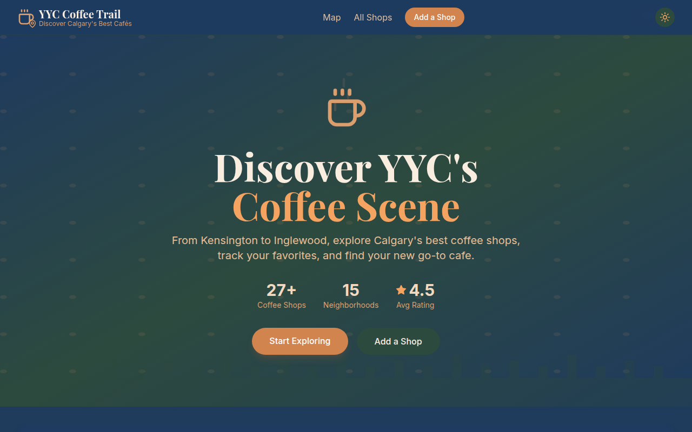

# Calgary Coffee Trail

**YYC Coffee Trail** is a Next.js app for exploring Calgary coffee shops on an interactive map, with search, filters and a page for each cafe.



> **Sample data:** The cafe list in `src/data/coffee-shops.ts` is demo data. Shop names and neighbourhoods refer to real Calgary cafes, but hours, ratings, review counts, features, addresses and coordinates are illustrative and may be wrong or out of date. They are not real reviews. Always check with the cafe before you go.

## Why

A small, map-first way to browse Calgary's coffee scene by neighbourhood and amenities, built as a project to practise the Next.js App Router, React context and Leaflet maps.

## Features

- **Interactive map** with Leaflet / React-Leaflet and CARTO tiles. Markers open a short popup for each shop.
- **Search and filters** by name, neighbourhood, "open now" (based on the sample hours), patio and Wi-Fi.
- **Shop detail pages** with hours, amenities, a directions link and nearby cafes.
- **"Add a shop" form** with client-side validation. It is a demo: nothing is sent or saved.
- **Dark mode** that follows the system setting and can be toggled.
- Responsive layout built with Tailwind CSS.

## Quick start

Requires Node.js 18.17 or later.

```bash
git clone https://github.com/mizoz/calgary-coffee-trail.git
cd calgary-coffee-trail
npm ci
npm run dev
```

Open http://localhost:3000.

Production build:

```bash
npm run build
npm start
```

## Project structure

```
src/
├── app/            # Pages: map home, /shops, /shops/[id], /add
├── components/     # Header, Footer, FilterBar, CoffeeShopCard, map components, StarRating
├── context/        # Theme and filter state (React context)
├── data/           # Sample coffee shop data and open-now helper
└── types/          # TypeScript types
```

## Tech stack

Next.js 14 (App Router), React 18, TypeScript, Tailwind CSS 3, Leaflet + React-Leaflet, Lucide icons.

## License

MIT © 2026 Ahmed Mahmoud. See [LICENSE](LICENSE).

Map data © [OpenStreetMap](https://www.openstreetmap.org/copyright) contributors, tiles by [CARTO](https://carto.com/attributions).
